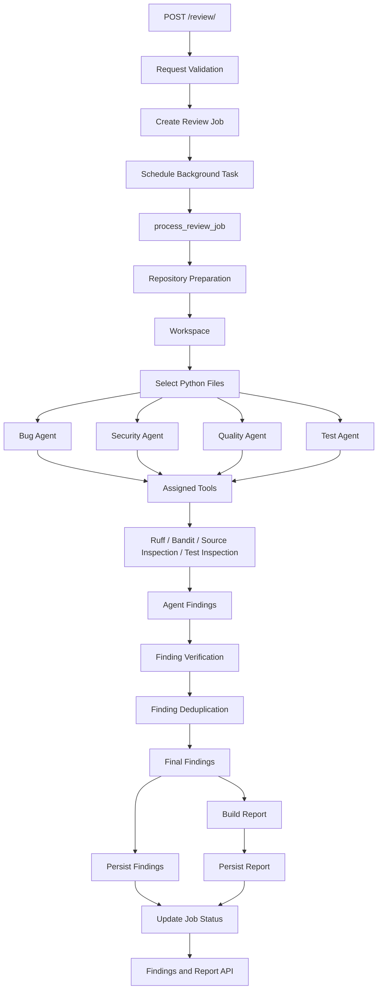

# CodeOPS-AI — Execution Traces & Data Flow

> **Status:** Implementation-aligned documentation. Updated 2026-11-02.
>
> **Purpose:** Describe how a review request moves through the currently implemented CodeOPS-AI application, how findings are processed, and where data is persisted.
>
> **Accuracy note:** This document describes the current architecture, not the original planned architecture. Implementation details that have not been independently verified against the latest source files are intentionally not stated as exact behavior.

---

## Table of Contents

1. End-to-End Request Trace
2. High-Level Data Flow
3. Finding Lifecycle
4. Repository Preparation
5. Static Analysis Through Agent Tools
6. Agent Tool-Calling Flow
7. Finding Verification
8. Finding Deduplication
9. Report Generation
10. Database Persistence
11. Failure Handling
12. Workspace Lifecycle
13. Test Coverage References
14. Implementation Notes

---

## 1. End-to-End Request Trace

This section describes the main lifecycle of a repository review.

```text
CLIENT
  |
  | POST /review/
  | Repository URL + commit SHA
  |
  v
FASTAPI
  |
  | Validate request using Pydantic
  | Create review job
  | Store initial job state
  | Register background task
  |
  v
HTTP RESPONSE
  |
  | 202 Accepted
  | Return job information
  |
  v
BACKGROUND PROCESSING
  |
  | process_review_job(job_id)
  |
  v
REVIEW SERVICE
  |
  | Prepare repository
  | Create isolated workspace
  | Select Python files
  |
  v
AGENT ANALYSIS
  |
  | BugAgent
  | SecurityAgent
  | QualityAgent
  | TestAgent
  |
  | Agents invoke their assigned tools
  | Ruff / Bandit / source inspection / test inspection
  |
  v
FINDING PROCESSING
  |
  | Collect findings
  | Verify findings
  | Remove duplicate findings
  |
  v
PERSISTENCE
  |
  | Save final findings
  | Build report
  | Save report
  | Update job status
  |
  v
CLIENT
  |
  | GET /review/{job_id}
  | GET /review/{job_id}/findings
  | GET /review/{job_id}/report
  |
  v
REVIEW RESULTS
```

The HTTP request and repository analysis are separate stages. The API accepts the review request and schedules background processing instead of requiring the client to wait for the entire analysis.

FastAPI documents this background-task execution model in its official documentation: [Background Tasks](https://fastapi.tiangolo.com/tutorial/background-tasks/).

---

## 2. High-Level Data Flow

The current architecture integrates static-analysis tools into the agents' analysis process.

There is no separate `StaticAnalyzer` service in the current implementation.



### Main components

| Component | Responsibility |
|---|---|
| FastAPI API | Accepts requests and exposes review results |
| Review job processor | Coordinates background review execution |
| Repository service | Prepares the repository workspace |
| Review service | Coordinates agents and finding processing |
| Agents | Analyze repository code for different issue categories |
| Agent tools | Perform deterministic code inspection and analysis |
| Tool executor | Manages agent tool calls |
| Finding verifier | Rejects findings that fail verification |
| Finding deduplicator | Removes duplicate findings |
| Report service | Builds the final review report |
| Database models | Persist jobs, findings, and reports |

---

## 3. Finding Lifecycle

A finding is produced by an agent or an analysis tool and passes through verification and deduplication before persistence.

### 3.1 Finding sources

The current finding schema distinguishes three sources:

- `ruff`
- `bandit`
- `ai_agent`

Static-analysis findings originate from deterministic tools. Agent findings originate from the LLM analysis.

### 3.2 Finding structure

The finding schema contains fields such as:

```python
Finding(
    source="ai_agent",
    category="bug",
    rule_id="",
    severity="high",
    confidence="medium",
    message="Example issue description",
    file_path="src/example.py",
    line=15,
    column=None,
    evidence="Example source code",
    recommendation="Example recommendation"
)
```

The values above illustrate the structure; they are not a real finding produced by a review.

The schema defines the allowed source, category, severity, and confidence values.

### 3.3 Finding normalization

Agent findings are normalized before entering the common finding-processing pipeline.

The agent determines its category and source. File paths are normalized to repository-relative paths.

This allows findings from different agents and tools to use a common structure.

### 3.4 Verification

The verifier checks findings against the repository workspace.

Depending on the finding and the configured checks, verification considers:

- Whether the referenced file exists.
- Whether the resolved path remains inside the workspace.
- Whether the reported line is valid.
- Whether supplied evidence can be found near the reported location.

Findings that fail verification are rejected rather than included in the final result.

### 3.5 Deduplication

Verified findings are passed to the deduplication service.

The deduplicator groups findings using their file path, line, and category, then identifies matching findings using their rule identifiers or normalized messages.

The goal is to avoid reporting the same issue multiple times while retaining distinct issues.

The selected finding preserves the strongest severity and confidence according to the implementation's ranking rules.

### 3.6 Persistence

The final findings are converted into database records associated with their review job.

The findings API exposes the persisted results.

---

## 4. Repository Preparation

**Implementation file:** `src/reviewer/services/repository.py`

The repository service prepares the source code that the agents will inspect.

The general flow is:

```text
Repository URL
      |
      v
Validate repository input
      |
      v
Create job-specific workspace
      |
      v
Clone repository
      |
      v
Fetch requested commit
      |
      v
Checkout requested commit
      |
      v
Return workspace path
```

The workspace is the working directory used by the review pipeline.

The exact Git commands, validation rules, subprocess options, and error handling should be treated as implementation details defined by `repository.py`, not inferred from this diagram.

---

## 5. Static Analysis Through Agent Tools

**Implementation file:** `src/reviewer/services/tools.py`

The previous architecture described a separate `StaticAnalyzer.analyze()` stage.

That description is obsolete.

The current architecture integrates static-analysis capabilities into the tools available to agents.

### Ruff

Ruff is used for Python code-quality and linting analysis.

The `run_ruff` tool allows an agent to request deterministic analysis and receive the resulting findings.

### Bandit

Bandit is used for Python security analysis.

The `run_bandit` tool allows the security agent to request deterministic security checks.

### Source inspection

The `inspect_source` tool allows an agent to inspect source files and obtain relevant code context.

### Existing test inspection

The `existing_test_inspection` tool allows the test agent to inspect existing test files.

### Tool responsibilities

| Tool | Purpose |
|---|---|
| `run_ruff` | Run Ruff analysis |
| `run_bandit` | Run Bandit security analysis |
| `inspect_source` | Inspect source code |
| `existing_test_inspection` | Inspect existing test files |

These tools are assigned to agents according to their analysis responsibilities.

There is no independent `src/reviewer/services/analyzer.py` stage in the current architecture.

---

## 6. Agent Tool-Calling Flow

**Implementation files:**

- `src/reviewer/services/tool_executor.py`
- `src/reviewer/services/tools.py`
- `src/reviewer/agents/bug_agent.py`
- `src/reviewer/agents/security_agent.py`
- `src/reviewer/agents/quality_agent.py`
- `src/reviewer/agents/test_agent.py`

### 6.1 Agent responsibilities

| Agent | Analysis responsibility |
|---|---|
| BugAgent | Identify potential bugs and incorrect behavior |
| SecurityAgent | Identify security weaknesses |
| QualityAgent | Identify code-quality and maintainability problems |
| TestAgent | Identify missing tests and testing weaknesses |

### 6.2 Tool assignments

The current assignments are:

| Agent | Assigned tools |
|---|---|
| BugAgent | `inspect_source`, `run_ruff` |
| SecurityAgent | `inspect_source`, `run_bandit` |
| QualityAgent | `inspect_source`, `run_ruff` |
| TestAgent | `inspect_source`, `existing_test_inspection` |

### 6.3 Tool-calling sequence

```text
Agent receives repository context
          |
          v
Agent receives assigned tool definitions
          |
          v
LLM processes the analysis request
          |
          v
LLM requests a tool call
          |
          v
Tool executor identifies requested tool
          |
          v
Tool executes against active workspace
          |
          v
Tool result is returned to the agent
          |
          v
LLM continues its analysis
          |
          v
Agent produces its findings
```

The tool executor manages the tool-calling loop.

The implementation applies execution limits to prevent unbounded tool interaction.

Known configured limits include:

- Maximum tool rounds: `5`
- Maximum tool findings: `20`
- Maximum test files: `50`
- Maximum source characters: `8000`
- Tool timeout: `120` seconds

These limits belong to the implementation and should be updated in this document if their source-code values change.

### 6.4 LLM configuration

The LLM provider and model configuration are defined through the project's configuration and model factory.

Do not describe this system as using Ollama unless the actual configuration and implementation are changed to use Ollama.

The current project context identifies Groq as the LLM provider.

---

## 7. Finding Verification

**Implementation file:** `src/reviewer/services/verifier.py`

The verifier is responsible for checking whether findings are supported by the repository.

```text
Candidate findings
       |
       v
FindingVerifier.verify()
       |
       v
Check referenced file
       |
       v
Check resolved path
       |
       v
Check reported line
       |
       v
Check supplied evidence
       |
       v
Accept valid findings
       |
       v
Reject invalid findings
       |
       v
Verified findings
```

The verifier is important because an LLM can produce findings that reference nonexistent files, incorrect lines, or unsupported evidence.

The verifier does not independently prove that the underlying issue is a real software defect. It validates the finding's relationship to the repository and its source evidence.

### Existing tests

File: `tests/test_verifier.py`

The test suite contains:

- `test_verifier_accepts_valid_finding`
- `test_verifier_rejects_hallucinated_line`
- `test_verifier_rejects_nonexistent_file`
- `test_verifier_rejects_path_traversal`
- `test_verifier_rejects_evidence_on_wrong_line`
- `test_verifier_accepts_multiline_evidence_at_line`
- `test_verifier_validates_tool_findings`

---

## 8. Finding Deduplication

**Implementation file:** `src/reviewer/services/deduplicator.py`

The deduplicator receives verified findings and removes duplicate issues.

```text
Verified findings
       |
       v
Group findings by location and category
       |
       v
Compare rule identifiers and messages
       |
       v
Identify duplicate findings
       |
       v
Select the strongest finding
       |
       v
Final findings
```

The grouping key is based on:

```python
(file_path, line, category)
```

Findings in different files, at different lines, or in different categories must not be incorrectly merged.

The deduplication process uses rule identifiers and normalized messages to identify matching findings.

The selected finding is determined using severity and confidence ranking.

### Existing tests

File: `tests/test_deduplicator.py`

The test suite contains:

- `test_merges_exact_duplicate_findings_on_same_line`
- `test_preserves_distinct_categories_on_same_line`
- `test_preserves_distinct_issues_with_different_rules_on_same_line`
- `test_retains_highest_severity_when_merging`
- `test_findings_in_different_files_never_merge`
- `test_findings_on_different_lines_never_merge`
- `test_preserves_evidence_and_recommendation_when_merging`
- `test_deduplicate_empty_list`

---

## 9. Report Generation

**Implementation file:** `src/reviewer/services/report.py`

The report service builds the final report from the review job and its findings.

The report generation process is template-based. It does not require an additional LLM call to generate the report.

The report contains six main sections:

1. Overview
2. Executive Summary
3. Findings Summary
4. Detailed Findings
5. Recommended Actions
6. Analysis Status and Limitations

### Report flow

```text
Review job + final findings
            |
            v
build_review_report()
            |
            v
Calculate finding statistics
            |
            v
Build executive summary
            |
            v
Build findings summary
            |
            v
Build detailed findings
            |
            v
Build recommended actions
            |
            v
Build analysis status
            |
            v
ReviewReportResponse
```

The final report is represented using the report response schema.

### Existing tests

File: `tests/test_report.py`

The test suite contains:

- `test_build_report_empty_findings`
- `test_build_report_with_findings_and_prioritization`
- `test_build_report_partial_review_status`
- `test_build_report_with_review_finding_db_objects`

The report persistence and API retrieval behavior is tested separately in `tests/test_report_persistence.py`.

---

## 10. Database Persistence

**Main implementation area:** `src/reviewer/api/api_review.py`

The review pipeline uses SQLAlchemy models to persist review information.

The main database entities are:

| Entity | Purpose |
|---|---|
| `ReviewJob` | Stores review job information and processing status |
| `ReviewFinding` | Stores individual findings associated with a review |
| `ReviewReport` | Stores the generated report associated with a review |

### Persistence flow

```text
Review request
      |
      v
ReviewJob created
      |
      v
ReviewJob processed
      |
      v
Final findings generated
      |
      v
ReviewFinding records persisted
      |
      v
Report generated
      |
      v
ReviewReport persisted
      |
      v
ReviewJob status updated
```

The background job processor creates its own database session for background processing.

This is separate from the request-handling database dependency.

### API access

The application exposes endpoints for retrieving:

- Review job information
- Review findings
- Review report

The report persistence tests cover successful retrieval, partial completion, reprocessing, and missing-report scenarios.

---

## 11. Failure Handling

The review pipeline must account for failures at different stages.

The following table describes the main failure categories. Exact exception handling and status transitions are governed by the implementation.

| Failure area | Possible effect |
|---|---|
| Invalid request | Request rejected before background processing |
| Invalid repository input | Repository preparation cannot proceed |
| Git operation failure | Repository preparation fails |
| Agent failure | Other agents may continue; review may be partially completed |
| Tool failure | The affected tool or agent may fail |
| LLM failure | The affected agent may fail |
| Invalid agent response | Agent findings may not be usable |
| Finding verification failure | Invalid finding is rejected |
| Database failure | Persistence or job processing may fail |
| Report failure | Report generation or persistence may fail |

### Important distinction

Not every failure should be treated as a complete review failure.

The lifecycle tests explicitly cover:

- Successful completion with findings.
- Partial completion after an agent failure.
- Fatal failure of the review job.

### Existing tests

File: `tests/test_review_lifecycle.py`

- `test_lifecycle_transitions_to_completed_with_findings`
- `test_lifecycle_transitions_to_completed_partial_on_agent_failure`
- `test_lifecycle_transitions_to_failed_on_fatal_exception`

File: `tests/test_review_service.py`

- `test_review_continues_when_one_agent_fails`
- `test_agent_and_tool_failures_record_agent_failures_without_false_success`

---

## 12. Workspace Lifecycle

The workspace contains the checked-out repository used during analysis.

```text
Review job begins
       |
       v
Repository workspace prepared
       |
       v
Active workspace context established
       |
       v
Agents request source and analysis tools
       |
       v
Tools access the active workspace
       |
       v
Verifier checks findings against workspace
       |
       v
Final findings and report generated
       |
       v
Review processing finishes
       |
       v
Workspace cleanup
```

The active workspace context is managed by the tool infrastructure.

The tool functions use this context to identify the repository on which they should operate.

### Context isolation tests

File: `tests/test_agent_tools.py`

- `test_active_workspace_context`
- `test_active_workspace_token_reset`
- `test_active_workspace_separate_contexts_isolated`

These tests cover workspace context behavior and isolation.

The exact cleanup mechanism and behavior on every exceptional path should be confirmed against the current repository and background-processing implementation.

---

## 13. Test Coverage References

The following table connects important components to their existing test files.

| Component | Implementation area | Test file |
|---|---|---|
| Agent tools and workspace context | `services/tools.py` | `test_agent_tools.py` |
| Tool execution | `services/tool_executor.py` | `test_agent_tools.py` |
| Finding deduplication | `services/deduplicator.py` | `test_deduplicator.py` |
| Finding verification | `services/verifier.py` | `test_verifier.py` |
| Review orchestration | `services/review.py` | `test_review_service.py` |
| Review API | `api/api_review.py` | `test_review_api.py` |
| Review lifecycle | `api/api_review.py` and review service | `test_review_lifecycle.py` |
| Report generation | `services/report.py` | `test_report.py` |
| Report persistence and retrieval | API and database models | `test_report_persistence.py` |
| PostgreSQL persistence | Database and report persistence | `test_postgres_integration.py` |

This table identifies existing test-file relationships. It does not claim that every function or branch in each implementation file is covered.

---

## 14. Implementation Notes

### 14.1 Removed architecture

The following references belong to the previous architecture and must not be used to describe the current implementation:

- `src/reviewer/services/analyzer.py`
- `StaticAnalyzer.analyze()`
- A separate baseline analyzer stage before agent execution
- `test_review_service_invokes_baseline_analyzer`
- A standalone `tests/test_static_analyzer.py` proposal

### 14.2 Current architecture

The current architecture integrates Ruff and Bandit into the tools assigned to agents.

The review service coordinates the agents and processes their findings.

### 14.3 Documentation boundaries

Each project document has a different responsibility:

| Document | Responsibility |
|---|---|
| `docs/spec.md` | Defines the system requirements and intended behavior |
| `docs/traces.md` | Describes actual execution flow and data movement |
| `docs/tdd.md` | Describes the test infrastructure, existing tests, and testing gaps |

These documents should agree about the system, but they should not repeat each other's responsibilities.

### 14.4 Updating this document

Whenever the implementation changes:

1. Inspect the changed source files.
2. Update the affected execution trace.
3. Update the corresponding test references.
4. Update `docs/tdd.md` if test coverage changes.
5. Check consistency with `docs/spec.md`.

**End of document.**