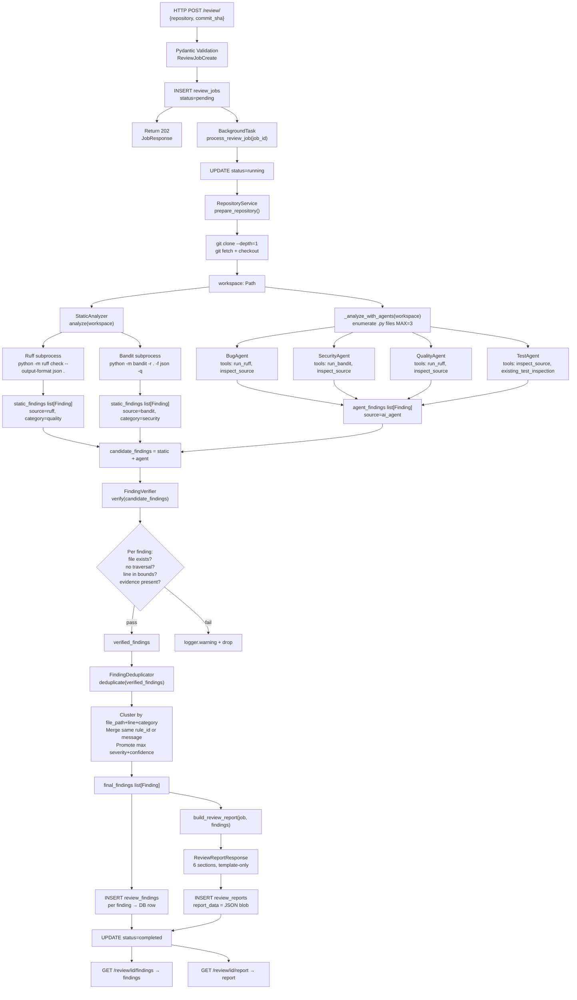

# CodeOPS-AI — Execution Traces & Data Flow

> **Status:** Reflects actual implementation as of 2026-11-02, including uncommitted working-tree changes. All traces are derived from reading the source code directly, not from the SDD.

---

## Table of Contents

1. [End-to-End Request Trace](#1-end-to-end-request-trace)
2. [Data Flow Diagram](#2-data-flow-diagram)
3. [Finding Lifecycle](#3-finding-lifecycle)
4. [Repository Preparation Trace](#4-repository-preparation-trace)
5. [Static Analysis Trace](#5-static-analysis-trace)
6. [Agent Tool-Calling Trace](#6-agent-tool-calling-trace)
7. [Verification Trace](#7-verification-trace)
8. [Deduplication Trace](#8-deduplication-trace)
9. [Report Build Trace](#9-report-build-trace)
10. [Database Write Trace](#10-database-write-trace)
11. [Failure Paths](#11-failure-paths)
12. [Workspace Lifecycle](#12-workspace-lifecycle)
13. [Log Events Reference](#13-log-events-reference)

---

## 1. End-to-End Request Trace

This trace follows a single `POST /review/` call from HTTP arrival to completed job.

```
CLIENT                    FastAPI                  BackgroundTask              PostgreSQL
  │                          │                           │                         │
  │  POST /review/           │                           │                         │
  │  {repo, commit_sha}      │                           │                         │
  ├─────────────────────────►│                           │                         │
  │                          │  Validate request body    │                         │
  │                          │  (Pydantic ReviewJobCreate)                        │
  │                          │                           │                         │
  │                          │  INSERT review_jobs       │                         │
  │                          │  status="pending"         │                         │
  │                          ├──────────────────────────────────────────────────►│
  │                          │◄──────────────────────────────────────────────────┤
  │                          │  job.id = UUID            │                         │
  │                          │                           │                         │
  │                          │  background_tasks.add_task(process_review_job, id) │
  │                          │  ↳ queued in BackgroundTasks                       │
  │                          │                           │                         │
  │  202 Accepted            │                           │                         │
  │  {id, status="pending"}  │                           │                         │
  │◄─────────────────────────┤                           │                         │
  │                          │                           │                         │
  │  [client may poll GET /review/{id} here]             │                         │
  │                          │                           │                         │
  │                          │  [after response sent]    │                         │
  │                          │  execute background task  │                         │
  │                          ├──────────────────────────►│                         │
  │                          │                           │                         │
  │                          │                 UPDATE status="running"             │
  │                          │                           ├────────────────────────►│
  │                          │                           │                         │
  │                          │                 RepositoryService.prepare_repository│
  │                          │                           │  git clone              │
  │                          │                           │  git fetch              │
  │                          │                           │  git checkout           │
  │                          │                           │  → workspace Path       │
  │                          │                           │                         │
  │                          │                 StaticAnalyzer.analyze(workspace)  │
  │                          │                           │  Ruff subprocess        │
  │                          │                           │  Bandit subprocess      │
  │                          │                           │  → static_findings[]    │
  │                          │                           │                         │
  │                          │                 _analyze_with_agents(workspace)     │
  │                          │                           │  BugAgent.analyze()     │
  │                          │                           │  SecurityAgent.analyze()│
  │                          │                           │  QualityAgent.analyze() │
  │                          │                           │  TestAgent.analyze()    │
  │                          │                           │  → agent_findings[]     │
  │                          │                           │                         │
  │                          │                 candidate = static + agent          │
  │                          │                           │                         │
  │                          │                 FindingVerifier.verify(candidate)   │
  │                          │                           │  → verified_findings[]  │
  │                          │                           │                         │
  │                          │                 FindingDeduplicator.deduplicate()   │
  │                          │                           │  → final_findings[]     │
  │                          │                           │                         │
  │                          │                 INSERT review_findings (bulk)       │
  │                          │                           ├────────────────────────►│
  │                          │                           │                         │
  │                          │                 build_review_report()               │
  │                          │                           │  → ReviewReportResponse │
  │                          │                           │                         │
  │                          │                 INSERT review_reports               │
  │                          │                           ├────────────────────────►│
  │                          │                           │                         │
  │                          │                 UPDATE status="completed"           │
  │                          │                           ├────────────────────────►│
  │                          │                           │                         │
  │  GET /review/{id}        │                           │                         │
  ├─────────────────────────►│                           │                         │
  │                          │  SELECT review_jobs       │                         │
  │                          ├──────────────────────────────────────────────────►│
  │  {status="completed"}    │◄──────────────────────────────────────────────────┤
  │◄─────────────────────────┤                           │                         │
```

---

## 2. Data Flow Diagram



---

## 3. Finding Lifecycle

A single finding goes through multiple transformations from birth to API response.

### 3.1 Birth

**Static finding (Ruff example):**
```
Ruff stdout JSON:
{
  "filename": "/tmp/workspace-abc123/src/main.py",
  "location": {"row": 42, "column": 89},
  "code": "E501",
  "message": "Line too long (92 > 88 characters)"
}

↓ StaticAnalyzer normalizes to:

Finding(
  source="ruff",
  category="quality",
  rule_id="E501",
  severity="low",         ← heuristic from rule prefix
  confidence="high",      ← always high for static tools
  message="Line too long (92 > 88 characters)",
  file_path="src/main.py",  ← made relative to workspace
  line=42,
  column=89,
  evidence=None,
  recommendation=None
)
```

**Agent finding (LLM example):**
```
LLM response content:
```json
[{
  "rule_id": null,
  "severity": "high",
  "confidence": "medium",
  "message": "Unhandled exception in database connection",
  "file_path": "src/db.py",
  "line": 15,
  "evidence": "conn = get_connection()",
  "recommendation": "Wrap in try/except and handle ConnectionError"
}]
```

↓ Agent model_validate + model_copy forces:

Finding(
  source="ai_agent",      ← forced
  category="bug",         ← forced by BugAgent
  rule_id=None,
  severity="high",
  confidence="medium",
  message="Unhandled exception in database connection",
  file_path="src/db.py",  ← normalized
  line=15,
  evidence="conn = get_connection()",
  recommendation="Wrap in try/except and handle ConnectionError"
)
```

### 3.2 Verification

```
FindingVerifier checks each Finding:

Check 1: file_path must resolve to a real file
  workspace / finding.file_path → Path.is_file() must be True
  Fail → WARNING log: "Finding rejected: file not found: src/missing.py"

Check 2: no path traversal
  resolved_path must start with workspace
  Fail → WARNING log: "Finding rejected: path traversal"

Check 3: line bounds (if line is not None)
  1 ≤ line ≤ len(file_lines)
  Fail → WARNING log: "Finding rejected: line out of bounds: line=999"

Check 4: evidence substring (if evidence is not None and line is not None)
  evidence strip must appear in lines[line-window : line+window]  (window=5)
  Fail → WARNING log: "Finding rejected: evidence not found near line N"

All checks pass → finding included in verified_findings
Any check fails → finding dropped entirely
```

### 3.3 Deduplication

```
FindingDeduplicator groups findings by cluster key:
  key = (file_path, line, category)

Within each cluster:
  For each pair of findings A, B:
    Match condition: A.rule_id == B.rule_id (and both non-None)
                  OR normalize(A.message) == normalize(B.message)
    normalize(): lowercase + strip punctuation + collapse whitespace

  If A matches B:
    Merge: keep finding with higher severity
           if same severity, keep higher confidence
           union of rule_ids (if available)

Output: one finding per cluster/group (deduplicated)
```

### 3.4 Persistence

```
For each final Finding:
  INSERT INTO review_findings (
    id = uuid4(),
    job_id = job.id,
    source = finding.source,
    category = finding.category,
    rule_id = finding.rule_id,
    severity = finding.severity,
    confidence = finding.confidence,
    message = finding.message,
    file_path = finding.file_path,
    line = finding.line,
    column_number = finding.column,
    evidence = finding.evidence,
    recommendation = finding.recommendation
  )
```

### 3.5 API Serving

```
GET /review/{id}/findings
  → SELECT * FROM review_findings WHERE job_id = id
  → list[ReviewFindingResponse]  (direct ORM → Pydantic)

GET /review/{id}/report
  → SELECT report_data FROM review_reports WHERE job_id = id
  → JSON deserialize → ReviewReportResponse
```

---

## 4. Repository Preparation Trace

**Source:** `src/reviewer/services/repository.py`

```
RepositoryService.prepare_repository(repository, commit_sha, job_id)

Input validation:
  repository.startswith("https://github.com/")
    → raises ValueError if not GitHub HTTPS

  re.match(r'^[0-9a-f-]{36}$', job_id)  ← UUID format
    → raises ValueError if invalid

Workspace creation:
  workspace = base_dir / job_id   (tempdir or configured path)
  workspace.mkdir(parents=True, exist_ok=True)

Git operations (subprocess.run, cwd=workspace):
  1. git clone --depth=1 <repository> .
     stdout/stderr captured; raises on non-zero exit

  2. git fetch --depth=1 origin <commit_sha>
     fetches specific commit by SHA

  3. git checkout <commit_sha>
     checks out the exact commit

Returns: workspace Path

Cleanup: workspace is cleaned up in finally block in process_review_job()
```

> **Note:** There is no SHA format re-validation inside `RepositoryService`. The 40-char hex constraint is enforced only by the Pydantic `ReviewJobCreate` schema at the API layer.

---

## 5. Static Analysis Trace

**Source:** `src/reviewer/services/analyzer.py`

```
StaticAnalyzer.analyze(workspace: Path) → list[Finding]

─── Ruff ────────────────────────────────────────────────────────────────

Command: python -m ruff check --output-format json .
CWD: workspace

subprocess.run(
  ["python", "-m", "ruff", "check", "--output-format", "json", "."],
  cwd=workspace,
  capture_output=True,
  text=True
)

stdout → json.loads() → list of ruff result objects

For each ruff result:
  filename → relative to workspace (Path.relative_to)
  path traversal guard: resolved path must start with workspace
  Skip if outside workspace

  Finding(
    source="ruff",
    category="quality",
    rule_id=result["code"],
    severity=_ruff_severity(result["code"]),  ← heuristic mapping
    confidence="high",
    message=result["message"],
    file_path=str(relative_path),
    line=result["location"]["row"],
    column=result["location"]["column"],
    evidence=None,
    recommendation=None
  )

─── Bandit ──────────────────────────────────────────────────────────────

Command: python -m bandit -r . -f json -q
CWD: workspace

subprocess.run(
  ["python", "-m", "bandit", "-r", ".", "-f", "json", "-q"],
  cwd=workspace,
  capture_output=True,
  text=True
)

stdout → json.loads() → results = data["results"]

For each bandit result:
  filename → relative to workspace
  path traversal guard

  Finding(
    source="bandit",
    category="security",
    rule_id=result["test_id"],            ← e.g. "B105"
    severity=result["issue_severity"].lower(),
    confidence=result["issue_confidence"].lower(),
    message=result["issue_text"],
    file_path=str(relative_path),
    line=result["line_number"],
    column=None,
    evidence=result.get("code"),           ← code snippet
    recommendation=None
  )

Returns: ruff_findings + bandit_findings
```

---

## 6. Agent Tool-Calling Trace

**Sources:** `src/reviewer/services/tool_executor.py`, `src/reviewer/agents/bug_agent.py` (representative)

### 6.1 Agent Initialization

```
BugAgent.analyze(workspace: Path, files: list[str])

  llm = create_chat_model()
    → ChatOllama(
        model=settings.llm_model,       # "qwen2.5:3b"
        base_url=settings.ollama_base_url,  # "http://localhost:11434"
        temperature=0
      )

  tools = [run_ruff, inspect_source]   ← LangChain @tool decorated

  bound_model = llm.bind_tools(tools)
    → model now knows tool schemas

  messages = [
    SystemMessage("You are a bug detection expert. Analyze the provided Python files...
                   Return findings as JSON array..."),
    HumanMessage(f"Analyze these Python files for bugs: {files}")
  ]
```

### 6.2 Tool-Calling Loop (`execute_agent`)

```
execute_agent(bound_model, messages, tools, max_rounds=5)

Round 1:
  response = bound_model.invoke(messages)
    → Ollama HTTP POST to http://localhost:11434/api/chat
    → Response: AIMessage with tool_calls=[
        ToolCall(name="run_ruff", args={"file_path": "src/main.py"})
      ]
  messages.append(response)

  tool_calls present → execute tools:
    tool_call = {name="run_ruff", args={"file_path": "src/main.py"}}
    result = run_ruff.invoke({"file_path": "src/main.py"})
      → _resolve_workspace() reads ContextVar → workspace path
      → subprocess: python -m ruff check --output-format json src/main.py
      → returns JSON string of findings (capped at MAX_TOOL_FINDINGS=20)
    
    _limit_tool_result(result)
      → truncate if result exceeds safe size
    
    messages.append(ToolMessage(
      content=result,
      tool_call_id=tool_call.id
    ))

Round 2:
  response = bound_model.invoke(messages)
    → Ollama sees tool result in context
    → Response: AIMessage with tool_calls=[
        ToolCall(name="inspect_source", args={"file_path": "src/main.py"})
      ]
  messages.append(response)
  
  Execute inspect_source → file contents returned
  messages.append(ToolMessage(content=file_contents, ...))

Round 3:
  response = bound_model.invoke(messages)
    → Ollama has ruff output + source code context
    → Response: AIMessage with NO tool_calls
      content = "```json\n[{\"severity\": \"high\", ...}]\n```"
  
  No tool_calls → return response

─── Back in agent.analyze() ───────────────────────────────────────────

  raw_content = response.content
  
  # Strip JSON fence
  if "```json" in raw_content:
    raw_json = raw_content.split("```json")[1].split("```")[0].strip()
  elif "```" in raw_content:
    raw_json = raw_content.split("```")[1].split("```")[0].strip()
  else:
    raw_json = raw_content.strip()
  
  raw_list = json.loads(raw_json)   ← may raise JSONDecodeError
  
  findings = []
  for item in raw_list:
    f = Finding.model_validate(item)
    f = f.model_copy(update={
      "source": "ai_agent",
      "category": "bug",
      "file_path": _normalize_path(f.file_path)
    })
    findings.append(f)
  
  return findings   # may be empty list if parse fails (exception caught)
```

### 6.3 Retry Behavior

```
invoke_with_rate_limit_retry(bound_model, messages, max_retries=3)

  Calls bound_model.invoke(messages)
  
  On requests.exceptions.ConnectionError:
    Wait 1s × (attempt + 1)
    Retry up to max_retries times
  
  On requests.exceptions.Timeout:
    Same backoff and retry logic
  
  Other exceptions: re-raise immediately
```

---

## 7. Verification Trace

**Source:** `src/reviewer/services/verifier.py`

```
FindingVerifier.verify(findings: list[Finding]) → list[Finding]

For each finding f in findings:

  Step 1 — Resolve path:
    resolved = (workspace / f.file_path).resolve()
    
  Step 2 — Existence check:
    if not resolved.is_file():
      logger.warning(f"Finding rejected: file not found: {f.file_path}")
      continue  ← DROP finding

  Step 3 — Traversal check:
    if not str(resolved).startswith(str(workspace.resolve())):
      logger.warning(f"Finding rejected: path traversal attempt")
      continue  ← DROP finding

  Step 4 — Line bounds check (only if f.line is not None):
    lines = resolved.read_text().splitlines()
    if not (1 ≤ f.line ≤ len(lines)):
      logger.warning(f"Finding rejected: line {f.line} out of bounds")
      continue  ← DROP finding

  Step 5 — Evidence check (only if f.evidence is not None and f.line is not None):
    window = 5
    start = max(0, f.line - 1 - window)
    end = min(len(lines), f.line + window)
    context = "\n".join(lines[start:end])
    if f.evidence.strip() not in context:
      logger.warning(f"Finding rejected: evidence not found near line {f.line}")
      continue  ← DROP finding

  All checks pass:
    verified_findings.append(f)

Return verified_findings
```

---

## 8. Deduplication Trace

**Source:** `src/reviewer/services/deduplicator.py`

```
FindingDeduplicator.deduplicate(findings: list[Finding]) → list[Finding]

Phase 1 — Cluster:
  clusters: dict[(file_path, line, category), list[Finding]] = {}
  
  For each finding f:
    key = (f.file_path, f.line, f.category)
    clusters[key].append(f)

Phase 2 — Within each cluster, find groups:
  normalize(msg: str) → msg.lower().translate(remove_punctuation).split() joined

  For each cluster:
    groups: list[list[Finding]] = []
    
    For each finding f in cluster:
      matched = False
      For each existing group g:
        representative = g[0]
        if (f.rule_id is not None and f.rule_id == representative.rule_id)
        OR normalize(f.message) == normalize(representative.message):
          g.append(f)
          matched = True
          break
      if not matched:
        groups.append([f])

Phase 3 — Merge each group into one finding:
  severity_rank = {critical:5, high:4, medium:3, low:2, info:1}
  confidence_rank = {high:3, medium:2, low:1}
  
  For each group:
    best = max(group, key=lambda f: (severity_rank[f.severity], confidence_rank[f.confidence]))
    final_findings.append(best)

Return final_findings
```

---

## 9. Report Build Trace

**Source:** `src/reviewer/services/report.py`

```
build_review_report(job: ReviewJob, findings: list[Finding]) → ReviewReportResponse

All logic is template-based. No LLM is called.

─── Section A: Overview ──────────────────────────────────────────────────
ReviewOverview(
  repository=job.repository,
  commit_sha=job.commit_sha,
  review_date=datetime.utcnow().isoformat(),
  total_findings=len(findings),
  status="completed"
)

─── Section B: Executive Summary ─────────────────────────────────────────
Count findings by severity:
  critical_count = sum(1 for f in findings if f.severity == "critical")
  high_count = ...  etc.

overall_assessment:
  if critical_count > 0:    → "Poor"
  elif high_count > 2:      → "Needs Improvement"
  elif high_count > 0:      → "Good"
  else:                     → "Excellent"

key_findings: Take up to 3 findings with highest severity, format as strings
recommendation: Canned string based on overall_assessment

─── Section C: Findings Summary ──────────────────────────────────────────
SeverityBreakdown(
  critical=critical_count,
  high=high_count,
  medium=medium_count,
  low=low_count,
  info=info_count
)
CategoryBreakdown(
  bug=sum(1 for f in findings if f.category=="bug"),
  ...
)

─── Section D: Detailed Findings ─────────────────────────────────────────
For each finding f:
  title = _format_finding_title(f)
    → if f.rule_id: f"{f.rule_id}: {f.message.split('.')[0]}"
    → else:         f.message.split('.')[0]
  
  DetailedFinding(
    id=str(uuid4()),
    title=title,
    source=f.source,
    category=f.category,
    severity=f.severity,
    confidence=f.confidence,
    file_path=f.file_path,
    line=f.line,
    evidence=f.evidence,
    recommendation=f.recommendation
  )

─── Section E: Recommended Actions ───────────────────────────────────────
For each finding f:
  RecommendedAction(
    priority=f.severity,          ← 1:1 copy
    action=f"Fix: {f.message}",   ← mechanical prefix
    rationale=_category_description(f.category),
    effort="Medium"               ← hardcoded always
  )

(Known gap: this is not aggregated or prioritised — it is a 1:1 copy of findings)

─── Section F: Analysis Status ───────────────────────────────────────────
AnalysisStatusAndLimitations(
  tools_used=list(set(f.source for f in findings)),
  files_analyzed=len(set(f.file_path for f in findings)),
  limitations=["Limited to 3 files per agent", "..."],
  confidence_level=_confidence_from_total(len(findings))
)

Return ReviewReportResponse(
  job_id=job.id,
  overview=...,
  executive_summary=...,
  findings_summary=...,
  detailed_findings=...,
  recommended_actions=...,
  analysis_status=...
)
```

---

## 10. Database Write Trace

**Source:** `src/reviewer/api/api_review.py` (`process_review_job`)

```
process_review_job(job_id: str)

  db = SessionLocal()    ← manually opened (not from get_db dependency)
  
  try:
    job = db.query(ReviewJob).filter(ReviewJob.id == job_id).first()
    
    job.status = "running"
    db.commit()
    
    workspace = review_service.review_repository(...)
    
    # Findings write (inside review_repository):
    for finding in final_findings:
      db_finding = ReviewFinding(
        id=uuid4(),
        job_id=job.id,
        source=finding.source,
        ...
      )
      db.add(db_finding)
    db.commit()
    
    # Report write:
    report = build_review_report(job, final_findings)
    db_report = ReviewReport(
      id=uuid4(),
      job_id=job.id,
      report_data=report.model_dump()   ← JSON serialized
    )
    db.add(db_report)
    db.commit()
    
    job.status = "completed"
    db.commit()
  
  except Exception as e:
    logger.exception(f"Review job {job_id} failed")
    job.status = "failed"
    job.error_message = str(e)
    db.commit()
  
  finally:
    db.close()
    # workspace cleanup (shutil.rmtree if exists)
```

> **Note:** The `process_review_job()` function opens its own `SessionLocal()` directly. This is because `BackgroundTasks` runs after the HTTP response is sent, so the request-scoped `get_db()` session would already be closed.

---

## 11. Failure Paths

### 11.1 Repository Clone Fails

```
RepositoryService.prepare_repository() raises subprocess.CalledProcessError

↓

process_review_job() except block:
  job.status = "failed"
  job.error_message = str(exception)
  db.commit()

workspace cleanup: finally block runs shutil.rmtree if workspace exists

Client sees:
  GET /review/{id} → {status: "failed", error_message: "Command 'git clone...' returned non-zero exit status 128"}
```

### 11.2 Agent JSON Parse Fails

```
LLM response does not contain valid JSON

↓

json.loads() raises JSONDecodeError

↓

agent.analyze() catches exception:
  logger.warning(f"Failed to parse agent response: {e}")
  return []   ← empty findings list for this agent

Pipeline continues with other agents' findings.
Job does NOT fail.
```

### 11.3 Verifier Rejects All Findings

```
All findings fail verification checks

↓

verified_findings = []
final_findings = []   (after dedup of empty list)

↓

No rows inserted into review_findings
build_review_report(job, []) runs:
  total_findings=0, overall_assessment="Excellent"

Job completes successfully with empty findings.
```

### 11.4 Static Analysis Tool Not Found

```
subprocess.run(["python", "-m", "ruff", ...]) raises FileNotFoundError
OR returns non-zero exit code

↓

StaticAnalyzer.analyze() catches exception:
  logger.warning(f"Ruff analysis failed: {e}")
  static_findings = []

↓

Pipeline continues with agent findings only.
```

### 11.5 Ollama Unavailable

```
ChatOllama.invoke() raises requests.exceptions.ConnectionError

↓

invoke_with_rate_limit_retry() retries 3 times with backoff

↓

After max retries, exception propagates

↓

execute_agent() propagates exception

↓

agent.analyze() catches exception:
  logger.exception("Agent analysis failed")
  return []

↓

Pipeline continues. All 4 agents return empty.
Static findings only (if Ruff/Bandit available).
```

### 11.6 Database Write Fails

```
db.commit() raises SQLAlchemyError

↓

process_review_job() except block:
  job.status = "failed"
  job.error_message = str(exception)
  db.commit()   ← second commit attempt (may also fail)

If second commit fails: exception is unhandled → logged by FastAPI
```

---

## 12. Workspace Lifecycle

```
Job submitted (POST /review/)
  │
  ▼
BackgroundTask starts
  │
  ├─ workspace dir created: <tempdir>/<job_id>/
  │   (RepositoryService.prepare_repository)
  │
  ├─ ContextVar set: _active_workspace = workspace Path
  │   (tools.py _resolve_workspace reads this)
  │
  ├─ git clone runs into workspace
  │
  ├─ StaticAnalyzer runs subprocess in workspace
  │
  ├─ Agents run (tools read files from workspace via ContextVar)
  │
  ├─ Verifier resolves file paths against workspace
  │
  ├─ Report built (no workspace access after this)
  │
  └─ finally block:
      if workspace.exists():
        shutil.rmtree(workspace)   ← cleaned up always

ContextVar is thread-local / task-local (asyncio context).
Each BackgroundTask gets its own context copy.
```

---

## 13. Log Events Reference

All logging uses Python's standard `logging` module. Logger names follow module paths.

| Event | Level | Location | Message Pattern |
|---|---|---|---|
| Job started | `INFO` | `api_review.py` | `"Starting review job {job_id}"` |
| Git clone success | `INFO` | `repository.py` | `"Repository cloned to {workspace}"` |
| Git clone failure | `ERROR` | `repository.py` | `"Git clone failed: {error}"` |
| Ruff analysis failure | `WARNING` | `analyzer.py` | `"Ruff analysis failed: {error}"` |
| Bandit analysis failure | `WARNING` | `analyzer.py` | `"Bandit analysis failed: {error}"` |
| Agent tool call | `DEBUG` | `tool_executor.py` | `"Executing tool: {tool_name}"` |
| Tool output truncated | `DEBUG` | `tool_executor.py` | `"Tool result truncated"` |
| Max rounds reached | `WARNING` | `tool_executor.py` | `"Max rounds reached for agent"` |
| Agent JSON parse failure | `WARNING` | `bug_agent.py` etc. | `"Failed to parse agent response: {error}"` |
| Agent complete failure | `EXCEPTION` | `bug_agent.py` etc. | `"Agent analysis failed"` |
| Finding rejected (file) | `WARNING` | `verifier.py` | `"Finding rejected: file not found: {path}"` |
| Finding rejected (traversal) | `WARNING` | `verifier.py` | `"Finding rejected: path traversal"` |
| Finding rejected (line) | `WARNING` | `verifier.py` | `"Finding rejected: line {n} out of bounds"` |
| Finding rejected (evidence) | `WARNING` | `verifier.py` | `"Finding rejected: evidence not found near line {n}"` |
| Dedup merged | `DEBUG` | `deduplicator.py` | `"Merged {n} duplicate findings"` |
| Report built | `INFO` | `report.py` | `"Report built: {n} findings"` |
| Job completed | `INFO` | `api_review.py` | `"Review job {job_id} completed"` |
| Job failed | `EXCEPTION` | `api_review.py` | `"Review job {job_id} failed"` |
| Ollama retry | `WARNING` | `llm_utils.py` | `"LLM connection error, retrying ({n}/{max})"` |

